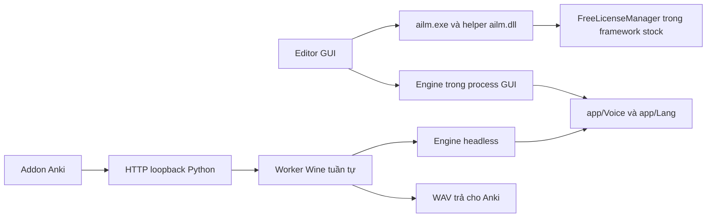

# Kiến trúc bản tích hợp

GUI và headless dùng cùng thư mục app/dữ liệu; process engine riêng để
không chia sẻ talker/settings giữa hai ứng dụng. Backend giữ một worker
nóng, tuần tự hóa tổng hợp và cache WAV. Addon chỉ gọi HTTP, phát preview
và lưu media khi khách đồng ý; không trực tiếp load DLL hoặc đọc credential.

`ailm.exe` stock là .NET host; `ailm.dll` mới chọn FreeLicenseManager và
trả message mà GUI đọc. Framework `AI.Framework.License.dll` giữ stock.
Patch snapshot `data/app.so` xử lý UX Deactivate, không sửa engine native.
Runtime engine/voice vẫn cần các file `.lic` đi kèm bộ được cung cấp.

File cấu hình có version, một app_dir và hai prefix. Xem
[RUNTIME_CONFIG_VI.md](RUNTIME_CONFIG_VI.md). Wine aliases V:/R:/O: trỏ tới
app/runtime/cache để native API nhận đường dẫn ASCII kể cả Linux path có dấu.

Managed runtime giữ shared lock khi GUI/worker chạy. Thao tác giọng cần
exclusive lock và kiểm tra process prefix, nên từ chối thay dictionary đang
được dùng. Thao tác quản lý không kill GUI mất nội dung. Service có tên theo
instance bản cài; stop/start chỉ tác động unit được ghi nhận của instance đó.

Cấu trúc quan trọng:

| Đường dẫn trong bản cài | Vai trò |
| --- | --- |
| app/ | App từ MSI, dữ liệu được chọn và patch đã kiểm chứng |
| runtime/ | Backend/worker/registry/CLI đã build, không cần compiler |
| config/runtime.json | Đường dẫn và endpoint dùng chung |
| prefixes/gui, prefixes/engine | Tạo mới tại máy khách |
| backups/stock | Helper/snapshot stock trước patch |
| backups/voices | Giọng đã gỡ và receipt/hash khôi phục |
| backups/integration | Addon cũ trước nâng cấp |
| manager/ | Source manager nhỏ để bảo trì sau khi xóa thư mục download |
| install-manifest.json | Danh sách file/hash và giọng của bản cài |
| integration.json | Unit/shortcut/addon thuộc bản cài này |

Cache/log mặc định theo XDG, không chứa trong app/Voice. Source/backend
không phụ thuộc Anki; mở rộng vntext được hoãn tới sau pipeline Anki.

API hiện tại: GET `/healthz` (ready và instance_id), GET `/v1/voices`, POST
`/v1/speak` (`text`, `voice`) trả WAV mono PCM16 48kHz. Text tối đa 4096 ký
tự/16384 byte UTF-8; request body tối đa 65536 byte. HTTP 400 cho input/voice
sai, 503 khi tổng hợp không sẵn sàng. Việc ngắt HTTP chưa hủy native synth.
Chưa có async jobs, streaming hoặc scheduler nhiều client; giới hạn đó là
P8, không phải tính năng đã hứa của bản Anki đầu tiên.
