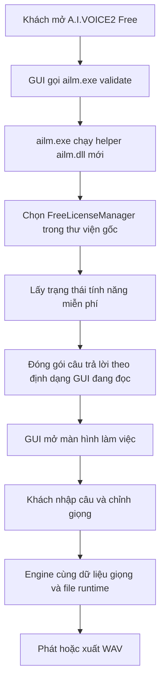
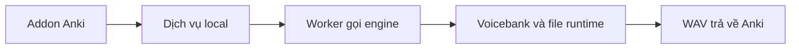

# A.I.VOICE2 Free: cơ chế và hướng dẫn dễ hiểu

Tài liệu cho bản thử **A.I.VOICE2 2.14.1**, cập nhật ngày 2026-11-06.

**Ý chính:** thay chương trình phụ kiểm tra license của GUI bằng một chương
trình phụ do mình viết, dùng chế độ miễn phí có sẵn trong thư viện gốc.
Khách mở GUI, chọn giọng và dùng; không phải nhập key hoặc tạo license tạm.
Engine đọc tiếng Nhật vẫn sử dụng các file runtime công ty cấp.

**Kiểm tra lại bộ cài gốc ngày 2026-11-06:** `msiextract --list` trên
`AIVoice2Editor.msi` liệt kê 326 file, không có `Lang/`, `.aildic`, `Voice/`
hoặc `.aivdic`. Hai file `Lang/standard/standard.aildic` và
`Lang/kansai/kansai.aildic` nằm ngoài MSI, cạnh bộ cài trong Downloads.
Cài mới phải bổ sung Lang từ nguồn đi kèm; nếu app đã có đủ bản tương thích
thì giữ nguyên. Danh sách file và hash MSI:
[msi-lang-inventory/result.json](evidence/free-client/msi-lang-inventory/result.json).

## 1. Mỗi file làm nhiệm vụ gì?

Có thể hình dung GUI là quầy điều khiển, helper là nhân viên trả lời về
quyền sử dụng, còn engine là máy tạo giọng nói.

| Thành phần | Vai trò dễ hiểu | Bản Free hiện tại làm gì? |
| --- | --- | --- |
| `aivoice.exe` | Chương trình mở cửa sổ Editor | Giữ nguyên từ MSI |
| `data/app.so` | Mã giao diện Flutter, gồm trang thông tin license | Patch đúng bản 2.14.1 để ẩn Deactivate và chặn callback cũ |
| `ailm.exe` | Chương trình khởi chạy helper .NET | Giữ nguyên từ MSI |
| `ailm.dll` | Chứa logic của helper mà `ailm.exe` chạy | **Thay bằng helper mới** |
| `AI.Framework.License.dll` | Thư viện chứa nhiều cách quản lý license, gồm `FreeLicenseManager` | Dùng bản nguyên gốc từ MSI |
| `aitalk_engine.dll` | Tạo âm thanh từ văn bản và cấu hình giọng | Giữ nguyên |
| `Lang/…/*.aildic` | Dữ liệu đọc/ngữ điệu tiếng Nhật, như standard và Kansai | Giữ file công ty cấp |
| `Voice/…/*.aivdic` | Dữ liệu từng voicebank | Giữ file công ty cấp |
| `Lib/AITalk/aitalk.lic` | File xác thực runtime của engine, đã có sẵn trong MSI | Giữ nguyên |
| `Voice/…/voice.lic` | File runtime đi kèm từng giọng | Giữ file công ty cấp |

**Hai chữ “license” ở đây chỉ hai lớp khác nhau:**

- Quyền dùng GUI: được helper mới xử lý bằng `FreeLicenseManager`.
- File xác thực engine/voicebank: vẫn được engine đọc khi tổng hợp audio.

Vì vậy **“khách không cần nhập key” không có nghĩa là xóa mọi file `.lic`**.
Các file đi kèm được cài cùng client, khách không cần thao tác với chúng.
Thử nghiệm đã xác nhận bỏ những file này làm engine/talker hoặc voicebank
không khởi tạo được qua API đang dùng.

## 2. Tại sao thay `ailm.dll` mà giữ `ailm.exe`?

Trong bộ cài này, `ailm.exe` là bộ khởi chạy .NET. Phần xử lý thực tế nằm
trong `ailm.dll` cùng thư mục. Dù đuôi file là `.dll`, nó có hàm `Main` để
chạy như chương trình khi được host .NET gọi.

GUI có thể gọi helper theo dạng:

```text
ailm.exe validate <mã tính năng>
```

Helper trả một dòng kết quả qua đầu ra văn bản của process. GUI đọc dòng
đó để biết quyền sử dụng tính năng. Giữ `ailm.exe` giúp giữ cách khởi chạy
và tên chương trình mà GUI vốn sử dụng; mình thay phần logic phía sau.

Source helper mới ở
[src/free-client/LicenseAdapter.cs](../src/free-client/LicenseAdapter.cs).
Biên dịch source này tạo ra `src/free-client/build/ailm.dll`, rồi chép file
đó vào **thư mục app thử** để thay `ailm.dll` ở đó.

## 3. Luồng chạy bản Free



Dòng quyết định trong source là:

```csharp
LicenseManager.Current = FreeLicenseManager.Current;
```

Có thể đọc là: **“Từ đây, dùng bộ quản lý miễn phí cho các lời gọi qua
LicenseManager trong helper này.”** Lệnh đó áp dụng trong process helper;
không phải tự đổi một biến trong mọi process GUI/engine đang chạy.

Khi GUI hỏi `validate`, helper thực hiện:

1. Lấy tính năng bằng `GetFeature` từ manager miễn phí.
2. Gọi `Authenticate`, rồi kiểm tra tính năng có được bật, đã xác thực và
   chưa hết hạn không.
3. Tạo thông tin trả về, gồm sản phẩm, trạng thái không phải trial, loại
   vĩnh viễn và thời gian từ feature. `activation_key` mang nhãn `Full version`.
   GUI cũ dùng trường này để hiển thị và lọc danh sách trong License
   Confirmation: để rỗng sẽ làm voicebank biến mất khỏi màn hình đó dù vẫn
   tạo giọng được. Nhãn này không phải key kích hoạt cá nhân.
4. Đóng gói và ký thông điệp bằng codec có sẵn trong framework gốc, rồi
   in ra một dòng để GUI đọc.

Phần ký là bước giữ đúng định dạng thông điệp local mà GUI hiểu; không gọi
máy chủ kích hoạt, không tạo fingerprint máy. Source gọi một hàm tĩnh private
trong `PretenderLicenseManager` để giữ codec này; **không tạo singleton
Pretender để lấy hoặc đăng ký license cá nhân**. Do phụ thuộc hàm private,
bản framework khác cần được kiểm tra lại trước khi dùng.

Trong DLL gốc đã thử, `FreeLicenseFeature` báo:

- `IsEnabled = true`: tính năng được bật.
- `IsAuthenticated = true`: đã xác thực theo chế độ miễn phí.
- `IsExpired = false`: chưa hết hạn.
- Loại `Product / Perpetual`: sản phẩm/vĩnh viễn.
- Bộ đếm và thời hạn ở giá trị tối đa.

Đã kiểm tra trực tiếp các thuộc tính, không chỉ suy đoán từ tên “Free”.
Chi tiết: [FREE_LICENSE_CAPABILITIES.md](FREE_LICENSE_CAPABILITIES.md).

Các lệnh quản lý kích hoạt cũ như `trial`, `activate`, `deactivate`,
`offline` hiện được helper tiếp nhận rồi kết thúc mà không đăng ký gì.
Đây là cách tránh quay về luồng trial/WMI; các lệnh đó **không thực hiện
chức năng quản lý license trả phí** trong client Free. Bộ cài/UX phát hành
cần phản ánh điều này nếu còn hiển thị menu kích hoạt cũ.

**Đã sửa nút Deactivate bằng patch UI `2.14.1-free-ui.1`:** ẩn nút và
lời hướng dẫn hủy kích hoạt; callback cũ trả về ngay nếu bị gọi. Danh sách
giọng và nhãn `Full version` vẫn còn. Chỉ no-op trong helper không đủ vì
GUI kiểm tra key trước khi gọi helper. Source và cơ chế chi tiết:
[FREE_CLIENT_DEACTIVATION.md](FREE_CLIENT_DEACTIVATION.md).

## 4. Khác gì với DLL đã patch trước đó?

Bản DLL người dùng đã patch đổi phần tạo license tạm từ 14 ngày thành
vĩnh viễn. Khi thử đúng DLL đó trên prefix sạch, GUI vẫn đi qua nhận dạng
máy/tạo license tạm và lỗi `BrokenWMI`, sau đó báo `Failed Authentication`.

Helper mới chọn manager miễn phí trước khi trả lời GUI. Trong ca thử sạch
đã chạy, GUI mở và nạp giọng mà không cần đi qua tạo license tạm. Đây là lý
do chọn hướng này cho máy khách mới. Không suy từ đó rằng bản patch trước
không chạy trên máy đã có trạng thái kích hoạt.

**Bản Free hiện tại dùng các file này:**

```text
AI.Framework.License.dll  ← nguyên gốc MSI 2.14.1
ailm.dll                  ← helper mới build từ LicenseAdapter.cs
data/app.so               ← UI patch build từ gui_patch.py
```

Nếu lấy một thư mục đang có DLL framework patch khác, chỉ chép thêm helper
mới vào chưa phải đúng cấu hình đã kiểm chứng. Nên dựng app từ MSI gốc như
bản review hiện tại; không trộn các phiên bản DLL theo tên file.

## 5. Khách hàng dùng bản thử trên máy này thế nào?

1. Trong menu ứng dụng Linux, mở **A.I.VOICE2 Free — Test**.
2. Chọn giọng và nhập câu tiếng Nhật.
3. Nghe thử, chỉnh tốc độ/cao độ/âm lượng hoặc xuất WAV như trong Editor.

Shortcut nằm ở:

```text
~/.local/share/applications/aivoice2-free-test.desktop
```

Nó gọi [open-test-gui.sh](../src/free-client/open-test-gui.sh), dùng:

```text
[WORKSPACE]/cache/free-client-review/app/       ← app thử
[WORKSPACE]/cache/free-client-review/prefix/    ← môi trường Wine riêng
[WORKSPACE]/cache/free-client-review/logs/gui.log ← log mới của launcher
```

**Wine prefix** là thư mục chứa Windows giả lập, registry và cài đặt của
chương trình chạy qua Wine. Prefix riêng giúp bản thử không dùng lại
registry/trạng thái kích hoạt trong `~/.wine-aivoice` của bản cũ.

Khách không cần biết các chi tiết đó để sử dụng. Shortcut thử hiện tại dành
cho máy này; chưa phải bộ cài tự động cho một máy khác.

## 6. Dành cho người chuẩn bị bản client

Phần này là thao tác build/chăm sóc bản thử, không phải việc khách phải làm.

### Build helper và patch UI

Trong workspace đã chuẩn bị:

```sh
cd [WORKSPACE]
python3 src/free-client/build.py
```

Script dùng compiler C# và assemblies .NET 6 đã có để tạo:

```text
src/free-client/build/ailm.dll
src/free-client/build/manifest.json
src/free-client/build/app.so
src/free-client/build/app.patch.json
```

Manifest ghi phiên bản helper, SHA-256, hash framework yêu cầu và hash
`ailm.dll` gốc. Script tự tìm .NET 8 SDK, cho phép chọn compiler bằng `--compiler`;
`--msi-app` và `--output-dir` chọn input/output trên máy build khác. Mặc định
vẫn dùng cây MSI đã trích xuất trong workspace nghiên cứu. Không yêu cầu khách cài compiler.

Script kiểm tra hash framework và snapshot GUI gốc để tránh dùng nhầm
ABI/codec hoặc ghi patch UI vào phiên bản khác. Manifest UI ghi đủ offset,
byte trước/sau và hash đầu ra; chỉ thay hai vùng, tổng cộng 39 byte mã.
Snapshot đã patch hoặc phiên bản khác sẽ bị từ chối. **Đây là kiểm tra tương thích file, không phải kiểm tra bản quyền
của khách.** File gốc không bị ghi đè bởi bước build.

### Cập nhật app review hiện có

Đóng cửa sổ **A.I.VOICE2 Free — Test** trước. Chỉ thao tác trên app review,
giữ bản sao của cả helper và snapshot GUI trước khi thay:

```sh
cd [WORKSPACE]
cp -n cache/free-client-review/app/ailm.dll cache/free-client-review/ailm.before-update.dll
cp -n cache/free-client-review/app/data/app.so cache/free-client-review/app.before-update.so
cp src/free-client/build/ailm.dll cache/free-client-review/app/ailm.dll
cp src/free-client/build/app.so cache/free-client-review/app/data/app.so
```

Không chép đè vào `.wine-aivoice` hay DLL cạnh MSI trong Downloads theo các
lệnh này. Bản review đã dùng framework stock đúng phiên bản; các lệnh trên
chỉ cập nhật helper và UI, không thiết lập app/prefix từ đầu. Không chạy
lệnh chép đè khi app đang mở; lượt triển khai này dùng thay file nguyên tử
để cửa sổ đang chạy giữ nguyên cho tới khi người dùng tự khởi động lại.

Mở lại shortcut rồi thử. Muốn kiểm tra rõ manager đang dùng, chạy:

```sh
WINEPREFIX=[WORKSPACE]/cache/free-client-review/prefix \
  wine [WORKSPACE]/cache/free-client-review/app/ailm.exe --free-client-info 1
```

Kết quả cần có `AI.Framework.License.FreeLicenseManager`, `IsEnabled` và
`IsAuthenticated` là `true`, `IsExpired` là `false`, loại Product/Perpetual.
Đây là lệnh diagnostic, không cần chạy mỗi lần mở GUI.

### Quay lại

- Muốn dùng Editor cũ ngay: mở shortcut **A.I.VOICE2 Editor** hiện có.
- Muốn lùi một lần cập nhật helper trong review: đóng bản Free, chép
  `cache/free-client-review/ailm.before-update.dll` trở lại
  `cache/free-client-review/app/ailm.dll`.
- Lùi patch UI: đóng bản Test và khôi phục snapshot từ
  `cache/free-client-review/gui-backups/app.stock-2.14.1.so` vào
  `cache/free-client-review/app/data/app.so`. Nút Deactivate cũ sẽ hiện lại
  và còn lỗi nếu dùng cùng helper Full version.
- `ailm.dll` stock ban đầu vẫn nằm trong cây MSI đã trích xuất. Khôi phục
  file stock sẽ khôi phục luồng kiểm tra license GUI cũ, bao gồm khả năng
  gặp lại lỗi WMI trên prefix sạch.

## 7. Headless/Anki có đi qua helper này không?

**Không.** Backend Anki hiện gọi trực tiếp API engine qua worker:



Worker tự gọi auth nội bộ với file engine/voice đi kèm; không cần mở GUI
hoặc gọi `ailm.exe`. Thay `ailm.dll` phục vụ quyền dùng GUI, không tự thêm
các tham số speed/pitch/volume vào API Anki hoặc đồng bộ preset hai bên.
Những chức năng tích hợp đó cần triển khai riêng.

## 8. Đã kiểm tra tới đâu?

Trong môi trường Wine mới, offline, không copy kích hoạt/registry cá nhân:

- GUI dùng helper mới mở được và nạp Akane NV, Aoi NV, Meika Hime NV,
  Meika Mikoto NV từ bộ công ty cấp.
- Xuất được WAV qua GUI với bốn giọng.
- Chỉnh tốc độ làm đổi thời lượng; chỉnh cao độ làm đổi PCM; chỉnh âm lượng
  làm đổi mức âm thanh trong file xuất.
- Engine/headless chạy sạch với bộ file công ty cấp đã được thử riêng.
- Bản UI patch ẩn nút/hướng dẫn Deactivate, giữ bốn thẻ Full version.
  Callback thử riêng với nút còn hiện: bấm chuột nhiều lần và phím Space
  không mở xác nhận, không gọi helper hủy kích hoạt. Xuất lại WAV Akane
  `です。` được 61.920 samples, mono 48 kHz, dài 1,29 giây.

Chưa gọi đây là kiểm thử mọi chức năng: chưa xác minh trên Windows VM,
mọi menu, preset persistence hay bộ cài tự động trên máy khách thứ hai.
Trong ca cô lập, kiểm tra file WAV; không dùng việc đó để khẳng định đã nghe
qua thiết bị âm thanh vật lý.

Ảnh, log, file WAV và số liệu đối chứng:
[FREE_CLIENT_REVIEW.md](FREE_CLIENT_REVIEW.md). Cơ chế GUI/headless gốc:
[GUI_HEADLESS_LICENSE.md](GUI_HEADLESS_LICENSE.md).
