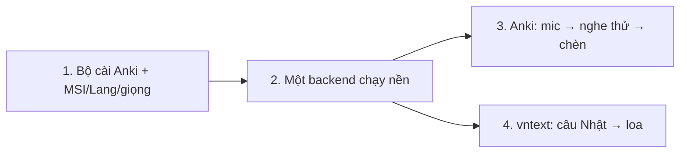
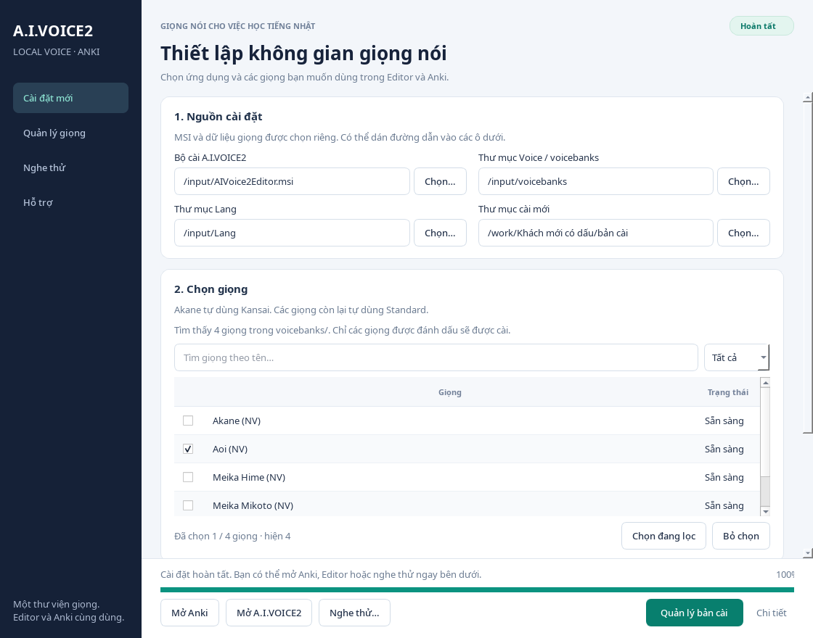
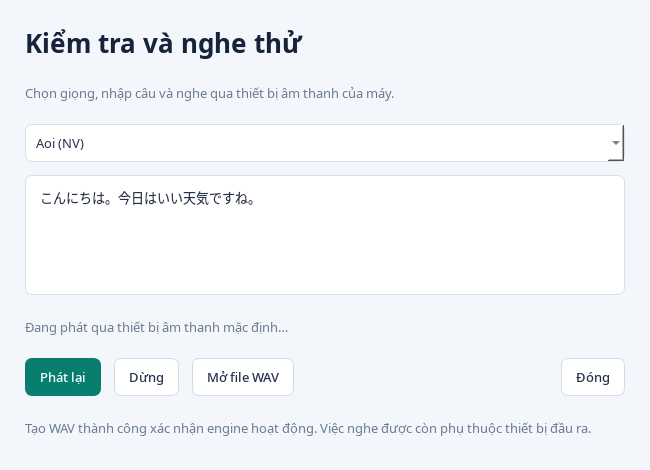

# Cài A.I.VOICE2 → nghe được trong Anki và vntext

Dành cho lần cài đầu trên **Linux x86-64**. Bộ cài **Anki 0.3.1 đã kèm
backend aivoice2api 0.1.0**. Chỉ cần tải bộ cài Anki và cài vntext;
không cần clone ba repo, build backend hoặc tự patch DLL.



## 1. Chuẩn bị đúng những thứ cần tải

| Cần có | Lấy ở đâu / nhận biết |
|---|---|
| Bộ tích hợp | [Tải aivoice2-anki-0.3.1.tar.gz](https://github.com/aquaplatinumberlitz/aivoice2-anki/releases/tag/v0.3.1), mục **Assets**; tải file `.tar.gz`, không chọn **Source code** để làm theo hướng dẫn này |
| MSI Editor | Nhận `AIVoice2Editor.msi` **2.14.1** từ bên bàn giao |
| Dữ liệu tiếng Nhật | Nhận thư mục `Lang` và thư mục chứa voicebanks từ bên bàn giao; MSI không có sẵn chúng |
| Anki Desktop | Cài bản Linux native theo [hướng dẫn chính thức](https://apps.ankiweb.net/), mở một lần để tạo profile rồi đóng trước khi setup |
| Môi trường Linux | Làm [chuẩn bị môi trường](ENVIRONMENT_VI.md) cho đúng distro; vntext overlay cần Wayland có layer-shell như KDE Plasma/Sway/Hyprland |

Repo và Release Anki/backend là **private**. Nếu thấy 404 dù link đúng,
cần được cấp quyền GitHub hoặc nhận trực tiếp gói `.tar.gz` từ bên bàn giao.
Không cần tài khoản GitHub khi đã nhận gói trực tiếp. Windows và Anki Flatpak
không thuộc luồng đã kiểm chứng này; GNOME không hỗ trợ dải nổi layer-shell.
Để cài cả pipeline qua kho gói chuẩn, chọn Arch/CachyOS, Ubuntu 26.04 trở
lên hoặc Debian 13; Ubuntu 24.04/22.04 cần xem giới hạn ở trang môi trường.

Giải nén `.tar.gz` bằng trình quản lý file, mở thư mục vừa giải nén.
Bên trong phải thấy `start-setup.sh`, `docs`, `src` và `build/payload`.
Bộ dữ liệu được cấp riêng có thể trông như sau, tên thư mục cha tùy bạn:

```text
du-lieu-duoc-cap/
  AIVoice2Editor.msi
  Lang/
    standard/standard.aildic
    kansai/kansai.aildic
  Voice/                     # hoặc tên voicebanks
    KotonohaAkane_ns_48/      # có thể chỉ được cấp một số giọng
    KotonohaAoi_ns_48/
```

**Xong bước này:** có bộ tích hợp và đủ ba nguồn MSI/Lang/Voice. Thiếu dữ
liệu thì xin lại bên bàn giao; tải riêng repo backend không bổ sung được chúng.

## 2. Chạy bộ cài và nghe một câu mẫu

Trong thư mục giải nén, chuột phải → **Mở terminal tại đây**, chạy:

```bash
bash start-setup.sh
```

Trong cửa sổ **Cài đặt mới**:

1. **Bộ cài A.I.VOICE2:** chọn file MSI vừa nhận.
2. **Thư mục Lang:** chọn `Lang`, không chọn riêng `standard`.
3. **Thư mục Voice / voicebanks:** chọn thư mục **chứa các giọng**, không
   chọn riêng một file `.aivdic`. Đánh dấu ít nhất một giọng sẵn sàng.
4. **Thư mục cài mới:** giữ mặc định nếu chưa tồn tại, hoặc chọn thư mục
   mới. Đây là nơi cài app, khác với thư mục giải nén và thư mục dữ liệu nguồn.
   **Ghi lại đường dẫn này** để chọn đúng bản cài khi bảo trì/hỗ trợ.
5. Giữ tùy chọn tạo dịch vụ khi đăng nhập, chọn kết nối Anki và đúng `addons21`.
   Anki native thường dùng `~/.local/share/Anki2/addons21`.
6. Bấm **Cài đặt và kiểm tra**, chờ **100% / Hoàn tất**. Bấm **Nghe thử…**,
   chọn giọng, nhập `こんにちは。`, bấm **Phát thử**.

<details>
<summary>Xem ảnh vị trí các ô và nút nghe thử</summary>





Ảnh từ bộ UI 0.2.0, được dùng minh họa vị trí thao tác vẫn giữ ở 0.3.1.
Đường dẫn và số giọng trong ảnh là ví dụ của phép thử cũ, không phải dữ liệu
cần nhập hoặc bằng chứng nghiệm thu mới.

</details>

**Xong bước này:** nghe đúng câu mẫu. Không nghe được thì xem output device/
âm lượng và [bảng lỗi ở cuối trang](#khi-gặp-lỗi); chưa cần mở Anki hoặc Editor.
Setup đã chuẩn bị GUI/helper và dữ liệu; không cần patch thêm bằng tay.

## 3. Lấy đúng URL backend để hai app dùng chung

1. Mở Anki → **Tools → Add-ons** → chọn **A.I.VOICE2 Local TTS** → **Config**.
2. Tìm dòng `api_url`. Setup đã điền URL backend của bản vừa cài, ví dụ
   `"api_url": "http://127.0.0.1:17862"`. Sao chép **chỉ phần URL**, không lấy
   dấu nháy, dấu phẩy hoặc tên `api_url`. Chưa cần đổi các setting khác.
3. Dán URL vào trình duyệt rồi thêm `/healthz`, ví dụ
   `http://127.0.0.1:17862/healthz`. Phải thấy JSON có `"ready": true` và
   `pcm-stream-v1` trong `capabilities`.

**Xong bước này:** lưu lại URL để dán vào vntext. Dùng URL thực tế trong
Config; cổng có thể là 17862, 17863 hoặc cổng khác. Nếu chưa thấy addon,
đóng Anki rồi dùng Quản lý → **Kết nối lại Anki…** với đúng `addons21`, sau
đó mở lại Anki. Nếu URL không kết nối, mở shortcut **Quản lý A.I.VOICE2 +
Anki**, chọn đúng bản cài → **Bật dịch vụ**, rồi thử lại. Mở Editor GUI không
thay cho bật backend.

Nếu cần tìm URL khi chưa có Anki hoặc nghi config đang trỏ bản khác, dev
hỗ trợ đọc runtime.json theo [hướng dẫn chẩn đoán](SUPPORT_VI.md).

## 4. Nghe và lưu tiếng trong Anki

1. Mở lại Anki → **Tools → Add-ons**: phải có **A.I.VOICE2 Local TTS**.
   Chưa có thì dùng Quản lý → **Kết nối lại Anki…**, đóng Anki khi cài addon.
2. Chọn addon → **Config**, kiểm `api_url` bằng URL bước 3. Setup thường
   đã điền đúng. Chỉ sửa URL nếu khác, giữ các setting còn lại.
3. Tạo note thử, nhập `こんにちは。` vào field tiếng Nhật. Dùng note type
   đang có hoặc **A.I.VOICE2 · Nhật–Việt**. Romaji/nghĩa Việt nhập riêng;
   addon chưa tự sinh hai phần này.
4. Bôi đen câu Nhật → bấm mic → làm mới giọng/chọn giọng → **Phát thử**.
5. Chọn đúng field audio rồi **Đồng ý · Chèn vào card**. Xem card thử và
   bấm phát audio. Đóng dialog mà chưa đồng ý thì note không bị chèn audio.

**Xong bước này:** nghe đúng câu, field có `[sound:...]`, card phát lại được.
Anki-Connect không bắt buộc. Audio đã chèn là media Anki, không phụ thuộc
việc giữ WAV trong cache backend.

## 5. Cài vntext và nối cùng backend

vntext hiện phát hành bằng source; cần build một lần theo
[hướng dẫn cài vntext](https://github.com/aquaplatinumberlitz/vntext/blob/main/docs/INSTALL_VI.md).
Trang đó có lệnh cài gói theo distro, build và đưa vntext vào menu.
Cần mạng để lấy source/dependency; không cần build lại aivoice2api.

Sau khi vntext mở được:

1. Bạn mở game tới một câu Nhật, chọn game trong vntext → **Hiện phụ đề**.
2. Trên dải → **Giọng đọc → Kết nối nâng cao**, dán URL bước 3.
3. Bấm **Làm mới giọng** để áp dụng, chọn giọng → **Nghe thử**.
4. Bấm loa cạnh câu Nhật trên dải. Chỉ bật **Tự đọc câu Nhật mới** nếu muốn
   tự phát khi game đổi câu; mặc định tắt để tránh đè lồng tiếng sẵn có.

**Xong bước này:** Anki và vntext đều phát được qua cùng backend. Không cần
mở Anki/Editor khi nghe từ vntext. Không tạo thêm một dịch vụ cho vntext.

## Khi gặp lỗi

| Dừng ở đâu / thông báo | Làm gì trước |
|---|---|
| GitHub 404 / không thấy Assets | Kiểm quyền repo private hoặc xin gói từ bên bàn giao |
| Không mở được setup / thiếu Qt, Wine, msiextract | Làm [ENVIRONMENT_VI](ENVIRONMENT_VI.md), chạy từ terminal để đọc lỗi |
| Không có giọng để chọn | Kiểm đúng thư mục chứa bank, đủ Lang/file giọng; dòng thiếu file có lý do trong bảng |
| Đích cài đã tồn tại | Chọn root mới; cần bảo trì bản đã cài thì mở Quản lý, không cài đè |
| Cài dừng trước 100% | Mở **Chi tiết**, đọc bước lỗi; giữ bản cài dang dở để hỗ trợ, không xóa dữ liệu nguồn |
| URL không kết nối | Đúng root/URL? Bật dịch vụ đúng instance trong Quản lý |
| Nghe thử không có tiếng | Kiểm âm lượng/output, thử **Mở file WAV**; xem [hỗ trợ](SUPPORT_VI.md) |
| Anki không có mic / addon | Khởi động lại Anki; kiểm đúng addons21 và dùng Kết nối lại Anki khi Anki đã đóng |
| vntext không build | Kiểm distro và phiên bản GTK ở hướng dẫn cài vntext; lỗi build khác lỗi TTS |
| Dải không có câu Nhật | Kiểm game/profile/focus theo [hướng dẫn vntext](https://github.com/aquaplatinumberlitz/vntext/blob/main/docs/USER_GUIDE_VI.md); thử Nghe thử trước để tách lỗi extraction khỏi TTS |

Không cần đọc RE, build worker hoặc chạy script nâng cấp để hoàn thành luồng
cài mới này. Dev hỗ trợ đọc tiếp [chỉ mục tài liệu](README.md); phần chẩn
đoán/nâng cấp sâu ở [aivoice2api CONNECT_VI](https://github.com/aquaplatinumberlitz/aivoice2api/blob/main/docs/CONNECT_VI.md).
